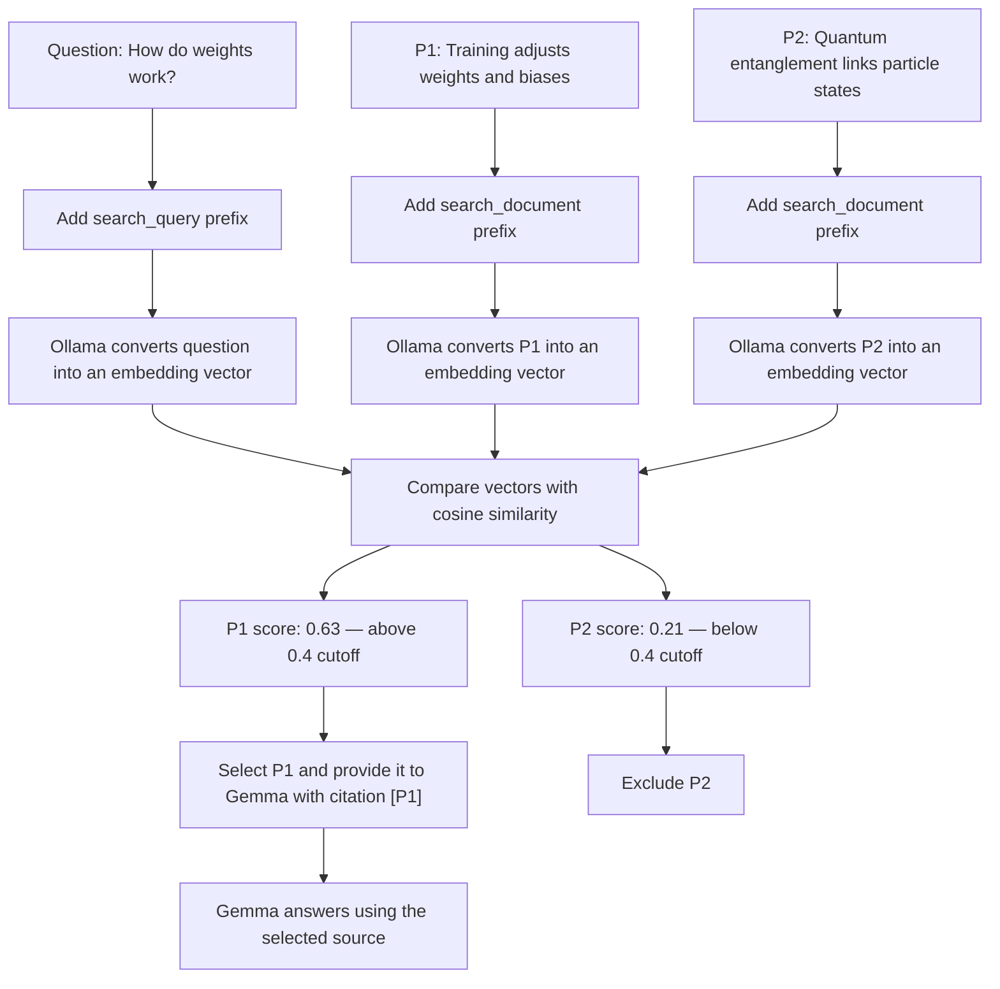

# Semantic Search in AI Peer

This diagram shows how AI Peer uses embeddings and cosine similarity to find source paragraphs that are relevant to a learner's question.

The scores are illustrative examples, not scores measured from the app. The current similarity cutoff is `0.4`.

## What the diagram demonstrates

- **Embedding:** Ollama turns text into a vector, a list of numbers representing its meaning.
- **Semantic matching:** A question and passage can use different words and still have similar vectors.
- **Cosine similarity:** AI Peer compares the question vector with each paragraph vector to rank passages by similarity.
- **Cutoff:** AI Peer keeps passages scoring at least `0.4`; it currently returns up to three.
- **Grounded answer:** Selected passages are sent to Gemma as reference material, with their original paragraph IDs for citations.

Nomic uses `search_query:` for questions and `search_document:` for source passages so it can treat each text according to its role in retrieval.
