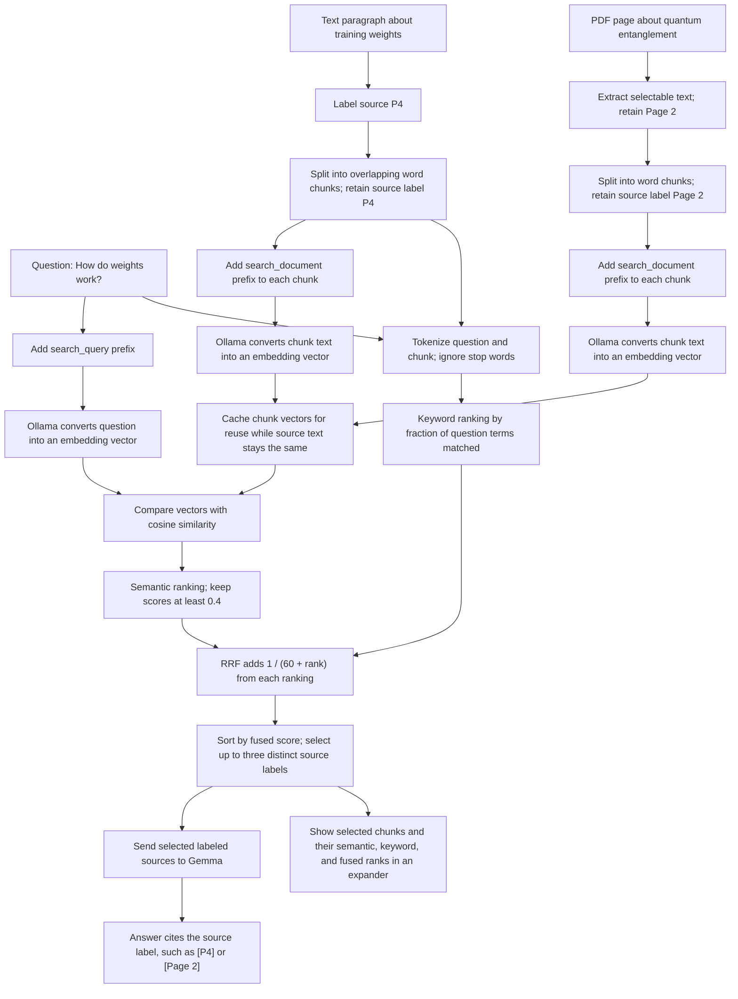

# Hybrid Retrieval in AI Peer

This diagram shows how AI Peer combines semantic similarity with exact keyword matching, then uses Reciprocal Rank Fusion (RRF) to rank relevant passages from labeled text or PDF sources.

The scores and ranks are illustrative examples, not values measured from the app. The current semantic similarity cutoff is `0.4`; RRF uses a rank constant of `60`.

## What the diagram demonstrates

- **Embedding:** Ollama turns text into a vector, a list of numbers representing its meaning.
- **Source labels:** Text paragraphs use labels such as `P4`; PDF pages use labels such as `Page 2`. The label stays attached to each passage.
- **PDF extraction:** Selectable page text can be extracted; image-only scanned pages need OCR, which is not implemented yet.
- **Chunking:** Long sources become overlapping word windows. Each chunk keeps its source label as metadata for citations.
- **Semantic matching:** A question and chunk can use different words and still have similar vectors.
- **Keyword matching:** AI Peer scores the fraction of useful question terms that appear in each chunk. This can help with exact names and terminology but does not itself match synonyms.
- **Reciprocal Rank Fusion:** The semantic and keyword lists have different score scales. RRF combines their rank positions by adding `1 / (60 + rank)` for each list containing a chunk, avoiding a hand-tuned weighted sum of raw scores.
- **Selection:** The semantic list applies the `0.4` cutoff; the keyword list keeps chunks with at least one matching useful term. AI Peer fuses the lists, then returns up to three chunks from distinct source labels.
- **Retrieval diagnostics:** The expandable panel shows selected chunks' semantic rank and score, keyword rank and score, and final fused rank and score. It helps explain the evidence selected for the answer; it does not display every candidate chunk.
- **Grounded answer:** Selected passages are sent to Gemma as reference material, with their original paragraph or page labels for citations.

RRF preserves the order of each input ranking but ignores the size of score gaps. The rank constant `60` is a fixed baseline here, not a value tuned against a benchmark for this project.

Nomic uses `search_query:` for questions and `search_document:` for source passages so it can treat each text according to its role in retrieval.
