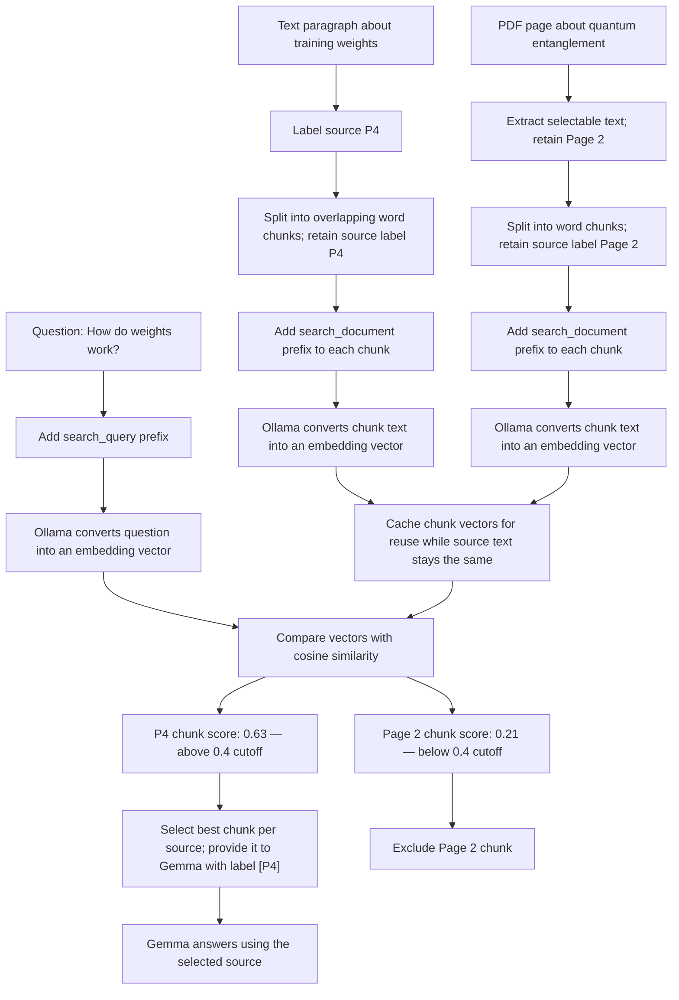

# Semantic Search in AI Peer

This diagram shows how AI Peer handles labeled text or PDF sources, chunks them, and uses embeddings and cosine similarity to find relevant passages.

The scores are illustrative examples, not scores measured from the app. The current similarity cutoff is `0.4`.

## What the diagram demonstrates

- **Embedding:** Ollama turns text into a vector, a list of numbers representing its meaning.
- **Source labels:** Text paragraphs use labels such as `P4`; PDF pages use labels such as `Page 2`. The label stays attached to each passage.
- **PDF extraction:** Selectable page text can be extracted; image-only scanned pages need OCR, which is not implemented yet.
- **Chunking:** Long sources become overlapping word windows. Each chunk keeps its source label as metadata for citations.
- **Semantic matching:** A question and chunk can use different words and still have similar vectors.
- **Cosine similarity:** AI Peer compares the question vector with each chunk vector to rank passages by similarity.
- **Cutoff:** AI Peer keeps chunks scoring at least `0.4`, then returns up to three chunks from distinct source labels.
- **Grounded answer:** Selected passages are sent to Gemma as reference material, with their original paragraph or page labels for citations.

Nomic uses `search_query:` for questions and `search_document:` for source passages so it can treat each text according to its role in retrieval.
